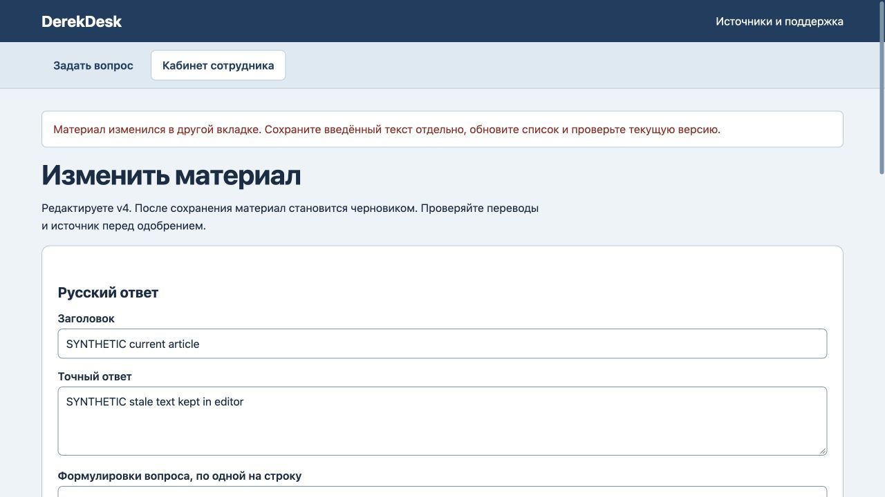

# DerekDesk: защита свежей правки и одобрения

25 октября2026. Исправлено перезаписывание более свежего материала старой формой и одобрение изменённого текста кнопкой из старого списка.

Оба HTTP-действия теперь требуют `expectedVersion`. Сервер сравнивает версию и выполняет запись в одной транзакции. При конфликте возвращается409;отсутствующая или некорректная версия даёт400. Новая правка по-прежнему снимает одобрение. Введённый текст старой формы сохраняется для ручного сравнения;автоматического объединения нет.

Проходят27 тестов:24 прежних и3 новые регрессии,все3 сначала упали. Проверены реальный файловый перезапуск и SQLite-копия.14 HTTP400/409 отказов сохранили все материалы,3 обращения и журнал9 приv4. Браузер отклонил старую правку с сохранением её текста;старое одобрение оставило весь материалv6/черновик,3 обращения и журнал11 неизменными. После обновления списка актуальное одобрение прошло;новый посетитель получил ответv6,сохранённый после перезагрузки. Три исходных обращения сохранили прежние снимкиv1;итог4 обращения/журнал13.

Основной DerekDesk перезапущен после проверки владения процессом. Все9 таблиц,включая5 прежних синтетических обращений,3 пользователей и журнал доступа,совпали по содержимому.18 остальных серверных рабочих областей не изменены и не перезапускались. Сервер остаётся локальным.

Проверка версии касается текста. Само одобрение не увеличивает версию;повторное одобрение того же текста допустимо. Прямые доверенные вызовы KnowledgeDesk сохраняют совместимость без обязательной версии,HTTP-пропуск запрещён. Старые вкладки/API-клиенты должны обновиться. Полного архива всех редакций и нового внешнего аудита безопасности нет;прошлое ревью доступа остаётся отдельным историческим доказательством.

[Доказательства](edit-verification.json) · [Репозиторий](https://github.com/wpalish/derekdesk)

